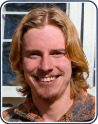

# Smart Greenhouse Management System

**COS 214 — Software Modelling | University of Pretoria | 2025**  
**Team FIVE GUYS**

A C++ greenhouse-management simulation developed to demonstrate object-oriented software design and the practical application of design patterns. The application models a nursery in which users can manage plants and inventory, coordinate staff, process customer orders, and view system summaries through a basic graphical interface.

## Features

- **Greenhouse inventory:** Add and organise plants, seeds, pots, and decorations.
- **Plant lifecycle and care:** Model plant states and perform care activities such as watering and fertilising.
- **Staff management:** Hire staff and coordinate nursery tasks.
- **Customer orders:** Assemble and sell greenhouse products to customers.
- **System overview:** View summaries of nursery operations.
- **Graphical interface:** Interact with the simulation through a GTKmm-based GUI.

## Technologies

- **Language:** C++11
- **GUI:** GTKmm 3
- **Build:** GNU Make
- **Design:** Object-oriented programming, UML, and software design patterns
- **Testing and analysis:** Project Makefile targets for tests, Valgrind, and coverage

## Architecture and design patterns

The project separates responsibilities for greenhouse inventory, plant behaviour, staff coordination, and customer orders. Its design uses patterns to keep these components modular and extensible.

Patterns represented in the project documentation and class diagram include:

| Pattern | Purpose in the system |
| --- | --- |
| **State** | Represent stages of a plant's lifecycle. |
| **Strategy** | Select different plant-care behaviours. |
| **Command** | Encapsulate staff tasks such as watering and fertilising. |
| **Chain of Responsibility** | Pass tasks between staff members. |
| **Mediator** | Coordinate communication between staff and other components. |
| **Builder** | Assemble customer orders. |
| **Composite** | Organise items into greenhouse sections. |
| **Iterator** | Traverse items and sections. |
| **Adapter** | Provide compatible interfaces for different product types. |
| **Decorator** | Add optional features to products. |
| **Prototype** | Clone plant-related objects. |
| **Bridge** | Separate plant abstractions from implementations. |

For the complete architecture and implementation details, see the [final project report](Documents/COS214%20Project%20Report%20Final.pdf).

### UML class diagram


[View the full-size class diagram](Documents/ClassDiagram.png)

## Building and running

These instructions reflect the project's original Makefile workflow. A Linux environment with a C++ compiler, GNU Make, and GTKmm 3 development files is recommended.

### 1. Install GTKmm

On Ubuntu/Debian:

```bash
sudo apt-get update
sudo apt-get install libgtkmm-3.0-dev
```

Ensure a C++ compiler and `make` are also installed.

### 2. Run the demo application

Open the Makefile in `Code/` and set:

```makefile
CXXFLAGS := -std=c++11 -Wall -Wextra -pedantic -g -Werror=delete-non-virtual-dtor
MAIN_FILE ?= DemoMain
```

From the `Code/` directory, run:

```bash
make run
```

The demo should launch a basic GUI for interacting with the greenhouse simulation.

### 3. Run the tests

In the same Makefile, use the same `CXXFLAGS` and change the entry point to:

```makefile
MAIN_FILE ?= testingMain
```

Then, from `Code/`, run:

```bash
make run
```

Additional Makefile targets used during development:

```bash
make valgrind
make coverage
```

> **Note:** These are the original project commands. They may require additional local dependencies or configuration depending on your operating system and compiler setup.

## Documentation

- [Final technical report (PDF)](Documents/COS214%20Project%20Report%20Final.pdf)
- [UML class diagram](Documents/ClassDiagram.png)
- [Source code](Code/)
- [Visual Paradigm design files](Visual%20Paradigm%20files/)

## Meet Team FIVE GUYS

This project was developed collaboratively by five University of Pretoria students. The team later continued working together on the Tyto PhishShield capstone project.

<div align="center">
<table>
<tr>
<td align="center" width="33%">
<br />
<strong>Josua Louw</strong><br />
<a href="https://github.com/Josua-Louw">GitHub</a> · <a href="https://www.linkedin.com/in/josua-perold-louw-bb8344398/">LinkedIn</a>
</td>
<td align="center" width="33%">
<br />
<strong>Daniel Darius Erasmus</strong><br />
<a href="https://github.com/DariusErasmus">GitHub</a> · <a href="https://www.linkedin.com/in/darius-erasmus-6a7549325/">LinkedIn</a>
</td>
<td align="center" width="33%">
<br />
<strong>Heindrich Jansen</strong><br />
<a href="https://github.com/Heindrich-Jansen">GitHub</a> · <a href="https://www.linkedin.com/in/hendrik-jansen-68a57a401/">LinkedIn</a>
</td>
</tr>
<tr>
<td align="center">
<br />
<strong>Nico Theron</strong><br />
<a href="https://github.com/Nico-Theron">GitHub</a> · <a href="https://www.linkedin.com/in/nico-theron-1068b9402/">LinkedIn</a>
</td>
<td align="center">
<br />
<strong>Frikkie Malan</strong><br />
<a href="https://github.com/FrikkieMalan">GitHub</a> · <a href="https://www.linkedin.com/in/frederick-malan-75618233/">LinkedIn</a>
</td>
<td align="center"></td>
</tr>
</table>
</div>

## Academic context

Developed for **COS 214 — Software Modelling** at the **University of Pretoria** in 2025. This repository is a fork of the original collaborative team project and is maintained here as a portfolio reference.
